# Doctor Tracker

A secure admin portal for managing doctors and the patients assigned to them, with an analytics dashboard.

| | |
|---|---|
| **Live demo** | _add the deployed URL here_ |
| **Demo login** | the admin from `backend/.env` (see [Demo credentials](#demo-credentials)) |
| **Stack** | Next.js 16 · React 19 · Tailwind CSS 4 · Redux Toolkit · Express 5 · MongoDB (Mongoose 9) · TypeScript |

<p align="center">
  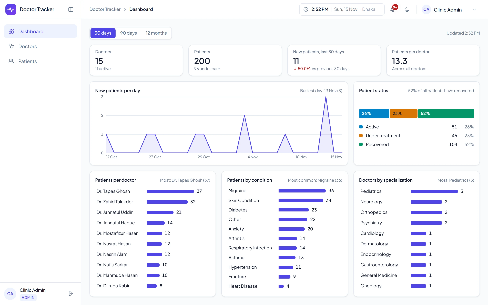
</p>

## Contents

1. [Description](#description)
2. [Features](#features)
3. [Setup Guide](#setup-guide)
4. [System Architecture](#system-architecture)
5. [Technical Decisions](#technical-decisions)
6. [Visual Evidence](#visual-evidence)
7. [Performance and query optimization](#performance-and-query-optimization)
8. [Security](#security)
9. [API reference](#api-reference)
10. [Testing](#testing)
11. [Scalability considerations](#scalability-considerations)
12. [Deployment notes](#deployment-notes)
13. [Project documentation](#project-documentation)

---

## Description

Doctor Tracker gives a clinic's administrators one secure place to run their doctor roster and patient records. Admins sign in, then:
- add doctors and search or filter them by specialization, hospital, status, joining date or experience;
- open any doctor to see, add and remove that doctor's patients;
- manage every patient from a dedicated page with search, date and condition filters, editing and reassignment to another doctor.

A dashboard turns the data into insight: totals, new patients over time against the previous period, the patient status split, and patients per doctor, condition and specialization. Every list is paginated and every search, filter and dashboard figure is served by an indexed MongoDB query. The interface is a responsive design that fits a laptop screen without scrolling and works the same on a phone.

## Features

**Authentication**
- Email and password sign-in for admins. Sessions use short-lived access tokens and rotating refresh tokens, both in `httpOnly` cookies.
- Every page and every API route is protected. Signed-out visitors are sent to `/login` and returned to the page they asked for after signing in.
- The Next.js proxy refreshes the session silently before rendering a page. The browser refreshes on a 401 (one refresh shared by parallel requests).

**Doctors** (`/doctors`, `/doctors/[id]`)
- Create, edit and delete doctors: name, specialization, hospital, phone, email, status, years of experience and joining date.
- Search by name, email or phone (prefix match on every word, indexed).
- Filter by specialization, hospital, status, joining date range and experience range. Each active filter shows as a removable tag.
- Sort by any column, paginate with 10, 20 or 50 rows, and keep everything in the URL, so filtered views are shareable and the back button works.
- A doctor still responsible for patients can't be deleted; the dialog explains why and links to them.
- The doctor profile shows contact details and patient counts by status. Below it, that doctor's patients appear with their own search, filters and pagination, and you can add, edit or delete patients there.

**Patients** (`/patients`)
- List, create, edit and delete patients.
- Move a patient to another doctor using a searchable doctor picker.
- Search by name, phone or email.
- Filter by status, condition, gender, doctor and admission date range, with sorting and pagination.

**Dashboard** (`/dashboard`)
- KPI tiles: total doctors (active), total patients (under care), new patients for the selected range with the change against the previous period, and patients per doctor.
- Ranges of 30 days, 90 days and 12 months. Buckets are per day, week or month, and empty buckets are filled with zero.
- Charts (hand-built SVG/HTML, colours validated for contrast and colour blindness):
  - new patients over time, with hover and keyboard read-out;
  - patient status split;
  - top doctors by patients;
  - patients by condition;
  - doctors by specialization.
- The whole dashboard comes from one API call. All aggregations run on indexes, and the result is cached for 60 seconds and cleared on any write.

**Interface**
- A collapsible sidebar on desktop (with your profile and sign-out at the bottom), an icon rail on tablets and a drawer on phones. The breadcrumb in the top bar shows where you are.
- Custom date and range pickers (day, month and year views, full keyboard support), animated dropdowns, and dashboard entrance motion. All of it respects "reduce motion".
- Top bar:
  - a Bangladesh clock with a calendar and user-added time zones;
  - a notification bell fed by real events (new doctor, doctor on leave with patients assigned, new patient, recovered, reassigned);
  - the light/dark theme switch.
- No layout shift: loading skeletons have the same size as the content they stand in for.
- Accessible: keyboard navigation everywhere, visible focus, ARIA patterns for the combobox, dialog, listbox and radio group, and WCAG AA contrast in both themes.

## Setup Guide

### Prerequisites

| Tool | Version |
|---|---|
| Node.js | 20.19 or newer (22 LTS recommended) |
| npm | 10 or newer |
| MongoDB | 8, either locally through Docker (`docker compose`) or a MongoDB Atlas cluster |

### 1. Clone

```bash
git clone <repository-url> doctor-tracker
cd doctor-tracker
```

### 2. Start MongoDB

**Option A: Docker (local)**

```bash
docker compose up -d          # MongoDB 8 on localhost:27017, data kept in a named volume
```

If port 27017 is taken, run `MONGO_PORT=27018 docker compose up -d` and use that port in `MONGODB_URI`.

**Option B: MongoDB Atlas.** Create a free cluster, allow your IP under *Network Access*, and copy the connection string.

### 3. Backend (Express API)

```bash
cd backend
cp .env.example .env          # PowerShell: Copy-Item .env.example .env
```

Edit `backend/.env`:
- `MONGODB_URI`: keep the Docker default, or paste your Atlas string (add the database name, e.g. `.../doctor_tracker`).
- `JWT_ACCESS_SECRET`: at least 32 random characters. Generate one with `node -e "console.log(require('crypto').randomBytes(48).toString('base64url'))"`.
- `ADMIN_EMAIL` / `ADMIN_PASSWORD`: the admin account the seed creates.

```bash
npm install
npm run seed                  # admin + 15 doctors + 200 patients + 25 notifications (demo data)
npm run dev                   # http://localhost:8082 (check: http://localhost:8082/api/health)
```

### 4. Frontend (Next.js)

In a second terminal:

```bash
cd frontend
cp .env.example .env.local    # PowerShell: Copy-Item .env.example .env.local
npm install
npm run dev                   # http://localhost:3000
```

Open **http://localhost:3000** and sign in with `ADMIN_EMAIL` / `ADMIN_PASSWORD`.

### Environment variables

Both apps ship an `.env.example` with every variable documented: [`backend/.env.example`](backend/.env.example) and [`frontend/.env.example`](frontend/.env.example).

| Backend variable | Default | Purpose |
|---|---|---|
| `NODE_ENV` | `development` | `production` turns on `Secure` cookies and hides error details |
| `PORT` | `8082` | API port |
| `MONGODB_URI` | — (required) | MongoDB connection string |
| `JWT_ACCESS_SECRET` | — (required, ≥ 32 chars) | signs the access token (HS256) |
| `ACCESS_TOKEN_TTL_SECONDS` | `900` | access token lifetime (15 min) |
| `REFRESH_TOKEN_TTL_DAYS` | `7` | refresh token lifetime |
| `FRONTEND_URL` | `http://localhost:3000` | origin allowed by CORS |
| `TRUST_PROXY` | `0` | reverse proxies in front of the API (set `1` on Render/Railway) so rate limits see the real IP |
| `APP_TIMEZONE` | `Asia/Dhaka` | decides "today" for date fields and dashboard ranges |
| `ADMIN_NAME` / `ADMIN_EMAIL` / `ADMIN_PASSWORD` | `Clinic Admin` / `admin@doctortracker.dev` / — | the account created by `npm run seed` / `npm run seed:admin` |
| `LOG_LEVEL` | `info` | pino log level |
| `SYNC_TARGET_URI` | — (optional) | second database kept identical by `npm run db:sync` |

| Frontend variable | Default | Purpose |
|---|---|---|
| `BACKEND_URL` | `http://localhost:8082` | the Express API. It's used by the `/api/*` rewrite (browser → Next → API) and by Server Components that call the API directly |

The API validates its environment with Zod at start-up and exits with a readable message if something is missing or wrong.

### Scripts

| Where | Command | What it does |
|---|---|---|
| backend | `npm run dev` | API with reload on change (tsx watch) |
| backend | `npm run build` · `npm start` | compile to `dist/` · run the compiled server |
| backend | `npm test` | 98 integration tests (Vitest + Supertest + in-memory MongoDB) |
| backend | `npm run typecheck` | TypeScript, no output |
| backend | `npm run seed` | demo data (replaces doctors, patients and notifications; keeps users). Refuses to run with `NODE_ENV=production` unless `--force` |
| backend | `npm run seed:admin` | creates or updates only the admin account (safe in production) |
| backend | `npm run db:explain` | prints the query plan and index used by every list, search, filter, dashboard and notification query |
| backend | `npm run db:sync -- --yes` | copies the database to `SYNC_TARGET_URI` (e.g. local → Atlas) |
| frontend | `npm run dev` | Next.js dev server |
| frontend | `npm run build` · `npm start` | production build · serve it |
| frontend | `npm run typecheck` · `npm run lint` | route types + TypeScript · ESLint (Next + React Compiler rules) |

### Troubleshooting

| Symptom | Fix |
|---|---|
| `Invalid environment configuration` on API start | a required variable is missing or too short; the message names it (most often `JWT_ACCESS_SECRET`) |
| `querySrv EBADRESP` with an Atlas `mongodb+srv://` string | some networks can't resolve SRV records; use Atlas's *standard* connection string (`mongodb://host1,host2,host3/...`) instead |
| Port 27017 or 8082 already in use | set `MONGO_PORT` for Docker, or `PORT` in `backend/.env` (and `BACKEND_URL` in `frontend/.env.local` to match) |
| Signed out right after signing in, on a deployed copy | the frontend must reach the API through its own `/api/*` rewrite (set `BACKEND_URL`), so the cookies stay first-party |

### Demo credentials

`npm run seed` creates one admin from `ADMIN_EMAIL` / `ADMIN_PASSWORD` in `backend/.env`. With the values in `.env.example` that is **`admin@doctortracker.dev` / `ChangeMe!2026`**. Change the password for any shared or deployed environment; credentials for the live demo are provided with the submission.

The demo data is Bangladesh-based: names, fictional hospitals in Dhaka, Chattogram, Sylhet, Rajshahi and Khulna, `+880` phone numbers, and dates in Asia/Dhaka time.

---

## System Architecture

### Services and data flow

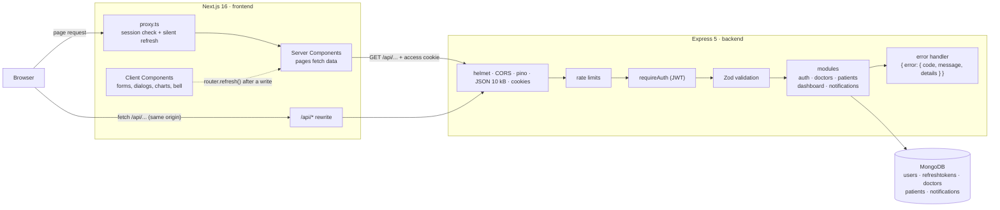

- **Pages read on the server.** A page's Server Component parses its URL (filters, sort, page), calls the API directly with the user's access-token cookie, and streams HTML. The browser never fetches list data itself.
- **Writes go through a same-origin rewrite.** Client components call `/api/*` on the Next.js origin, and Next forwards the call to Express. The session cookies are therefore first-party, and there is no CORS for the browser to deal with. After a successful write, the component calls `router.refresh()` and the server re-renders with fresh data.
- **Express is layered:**
  - security headers, CORS, logging, a 10 kB body limit and cookies;
  - rate limits;
  - authentication;
  - Zod validation of params, query and body;
  - a feature module (route → controller → service → Mongoose model);
  - one error handler with a single error shape.
- **MongoDB** holds five collections. Every query a screen makes is backed by an index (see [Performance](#performance-and-query-optimization)).

### Authentication flow

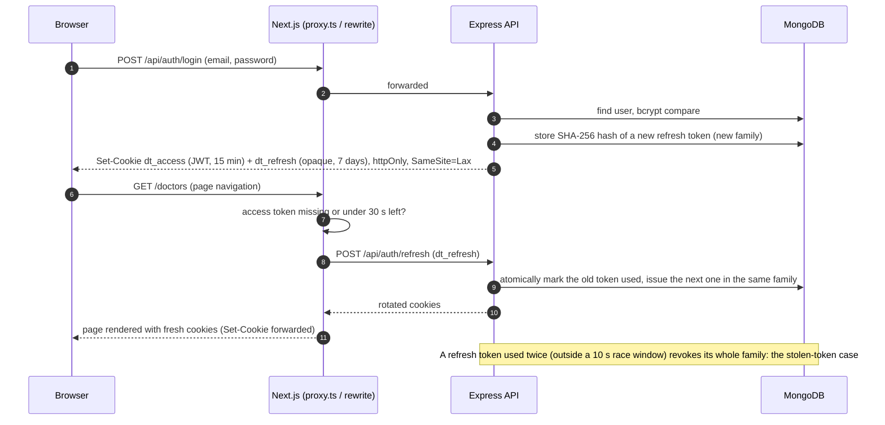

### Data model

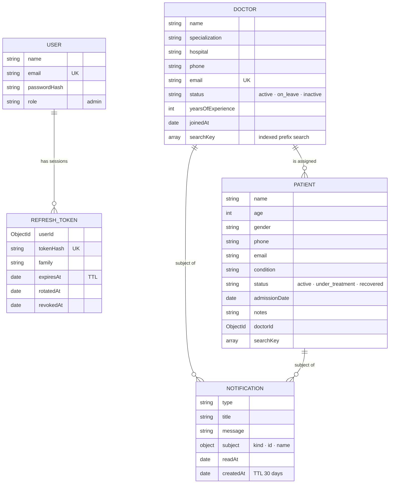

### Project structure

```
doctor-tracker/
├── backend/                     Express 5 API (TypeScript, ESM)
│   ├── src/
│   │   ├── app.ts               middleware chain
│   │   ├── routes.ts            /api router
│   │   ├── config/              env (Zod-validated), database
│   │   ├── middleware/          auth, rate limits, not-found, error handler
│   │   ├── lib/                 validation helpers, pagination, search keys, dates, TTL cache
│   │   ├── modules/             auth · doctors · patients · dashboard · notifications
│   │   │                        (each: model, schema, service, controller, routes)
│   │   └── scripts/             seed, seed-admin, explain-queries, db-sync
│   ├── tests/                   Vitest + Supertest integration tests
│   └── .env.example
├── frontend/                    Next.js 16 App Router
│   ├── src/
│   │   ├── proxy.ts             route protection + silent session refresh
│   │   ├── app/                 (auth)/login · (app)/dashboard, doctors, doctors/[id], patients
│   │   ├── features/            auth · doctors · patients · dashboard · notifications · clock
│   │   │                        (types, server reads, client writes, schemas, components)
│   │   ├── components/ui/       hand-built primitives: Button, Select, Dialog, DataTable, Pagination…
│   │   ├── components/layout/   sidebar, top bar, mobile drawer, account menu
│   │   ├── hooks/ · lib/        fetch layer, URL params, formatting · Redux store (UI state)
│   │   └── store/
│   └── .env.example
├── docs/
│   ├── design-system.md         tokens (primitive → semantic → component), scales, component states
│   ├── doctor-tracker/          plan, feature log, FE guide, QA guide, module walkthroughs
│   └── screenshots/             README images
└── docker-compose.yml           local MongoDB 8
```

---

## Technical Decisions

### 1. Sessions in `httpOnly` cookies with rotating refresh tokens, behind a same-origin proxy (instead of a JWT in `localStorage`)

**The problem.** The portal holds personal medical data, and the spec asks for "secure login" with every route protected. The usual shortcut is to keep a long-lived JWT in `localStorage` and send it as a `Bearer` header. Any script that runs on the page can read it, though (an XSS bug, or a compromised dependency), and a stolen token stays valid until it expires. Server-rendered pages also can't see `localStorage`, so the server could never render protected data on the first request.

**What we built.**
- **Two tokens, two jobs.**
  - The *access token* is a JWT (HS256, 15 minutes, `dt_access` cookie). Every protected API request verifies it statelessly, with no database lookup.
  - The *refresh token* is 48 random bytes (`dt_refresh`, 7 days). The database stores only its SHA-256 hash, so a database leak exposes no usable token.
- **Cookies the page can't touch.** Both cookies are `httpOnly` (invisible to JavaScript), `SameSite=Lax` (not sent on cross-site POST/PATCH/DELETE, which blocks CSRF) and `Secure` in production.
- **Rotation with reuse detection.** Every refresh atomically marks the old token used (`findOneAndUpdate` on `rotatedAt: null`) and issues a new one in the same *family*. If a token that was already rotated shows up again, someone else has it, and the whole family is revoked. A 10-second grace window keeps parallel tabs refreshing at the same moment from being flagged as theft.
- **Same-origin through Next.js.**
  - The browser talks only to the Next.js origin, and `/api/*` is rewritten to Express, so the cookies are first-party in production too (Vercel in front of Render) and CORS never enters the picture for users.
  - `proxy.ts` reads the access token's expiry before rendering a protected page and refreshes it if it has less than 30 seconds left. The rotated cookies go both to the browser and into the current render, so a page never fails on an expired token. Prefetch requests are excluded, so hovering links doesn't spend refreshes.
  - In the browser, `clientFetch` retries once after a single-flight refresh: ten parallel 401s cause one refresh call.
- **Abuse limits.** Sign-in allows 10 failed attempts per 15 minutes, refresh allows 60 calls per 15 minutes, and the whole API allows 600 requests per 15 minutes.

**Trade-offs we accepted.** There are more moving parts than one bearer token: a refresh endpoint, a token collection with a TTL index, and cookie forwarding in the proxy. Refreshing costs one indexed database write. Revocation takes effect at the next refresh, so a stolen access token lives at most 15 minutes. In return:
- no script can steal a session;
- a replayed refresh token locks the attacker out;
- protected pages render on the server on the first request.

### 2. Server Components with the URL as state; Redux Toolkit only for UI state (instead of fetching and caching server data on the client)

**The problem.** Most of the app is list pages with search, several filters, sorting and pagination, plus a dashboard. The common pattern is to fetch in `useEffect` (or RTK Query) and keep the results in a client store. It produces loading waterfalls after hydration and duplicated server state with cache-invalidation bugs. It also leads to large client bundles and broad re-renders whenever a store slice changes. The spec explicitly asks for "proper state management and data fetching strategies" and to "avoid unnecessary re-renders".

**What we built.**
- **The URL is the state for anything that shapes data.** `/patients?status=recovered&doctorId=…&page=2` is the whole state of that screen. The page's Server Component parses it and silently drops invalid values (a hand-edited URL never errors). It then fetches the page of rows (plus helper data such as the hospital list) in parallel and streams the result. Views are shareable, the back button works, and a refresh shows the same thing.
- **Changes are transitions, not loading screens.** Filters, search (debounced 300 ms), sorting and paging call `router.replace(url)` inside `startTransition`. React keeps the current rows on screen, dimmed (`aria-busy`), until the server sends the next page, so nothing flashes to a skeleton or jumps. Skeletons appear only on the first visit, cut to the exact size of the real content.
- **Writes are explicit.** A dialog validates with React Hook Form + Zod (mirroring the API's rules). It calls the API, maps any field errors from the server back onto the inputs, shows a toast, and calls `router.refresh()`. The server, not a client cache, decides what the next screen shows, so nothing can drift out of sync.
- **Redux Toolkit holds only UI state:** sidebar collapse, theme, mobile drawer, which dialog is open, toasts, the signed-in user for client widgets, and the breadcrumb tail on detail pages. These are small slices with memo-friendly selectors, so opening a dialog doesn't re-render a table. Server data is never copied into Redux.
- **Static shell, streamed data.** With Cache Components, the app shell (sidebar, top bar) is prerendered and instant on navigation, and only the data parts stream behind `Suspense`. The React Compiler handles memoisation automatically, so there are no hand-written `useMemo` / `useCallback`.

**Trade-offs we accepted.** Every filter change is a server round trip rather than an in-memory filter. That's cheap here because every list query is index-backed (single-digit milliseconds) and the dashboard is cached for 60 seconds. List updates aren't optimistic, except in the notification bell, where an instant "mark as read" matters. We don't need a client cache library or a store full of entities, the list pages ship less JavaScript, and the data on screen always comes straight from the server.

### Other decisions, briefly

- **No component library.** The primitives (Select, Dialog/bottom sheet, Popover, DataTable with phone cards, Pagination, async combobox, calendar with date and range pickers, suggestion field) are hand-built on WAI-ARIA patterns, styled with Tailwind tokens, and animated with `motion`. The tokens come in three layers (primitive → semantic → component). Tailwind's own palette is switched off, so components can only use them. See [docs/design-system.md](docs/design-system.md).
- **Charts are hand-built (SVG + HTML) instead of Recharts.** There are five simple charts. Building them gives exact styling in both themes, server rendering and real-component tooltips with no chart bundle. Colours were checked with a palette validator for lightness, colour-blind separation and 3:1 contrast.
- **Search uses prefix keys instead of `$text` or unanchored regexes.** Each document stores lower-cased name words, the email and the phone digits in an indexed `searchKey` array. A search becomes anchored regexes (`$all: [/^nus/, /^jah/]`) answered by an index range scan.
- **Delete guard instead of cascade.** Deleting a doctor who still has patients returns `409 DOCTOR_HAS_PATIENTS`, so patient records are never removed by accident.
- **Notifications come from domain events.** Doctor and patient writes record events (new doctor, doctor on leave with patients still assigned, new patient, recovered, reassigned). Notifications expire after 30 days through a TTL index.

---

## Visual Evidence

All screenshots are from the production build with the seeded demo data, taken at 2× pixel density.

### Desktop (1440 × 900)

| | |
|---|---|
| 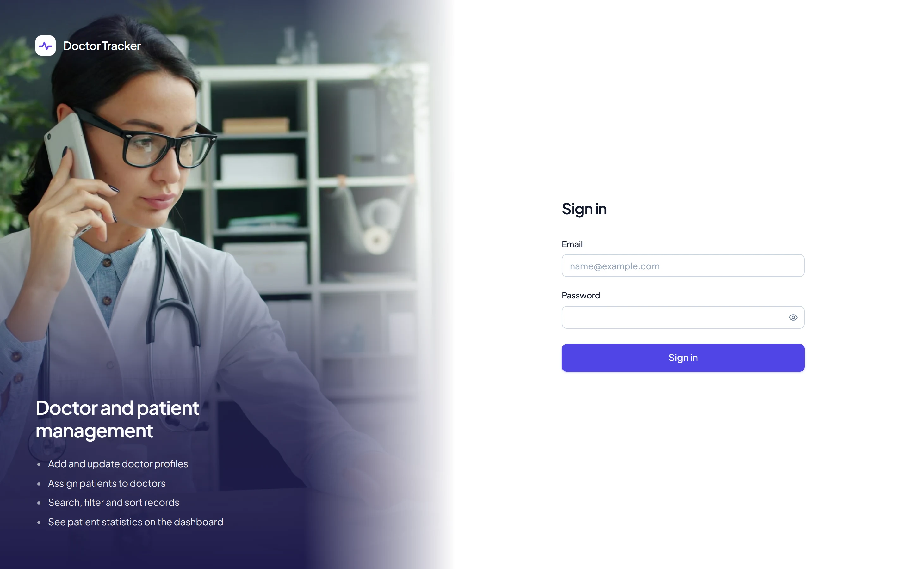 |  |
| **Sign in** | **Dashboard (30 days)** |
| 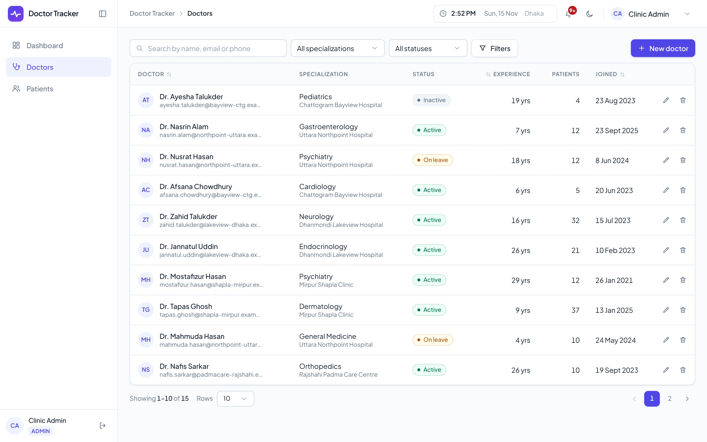 | 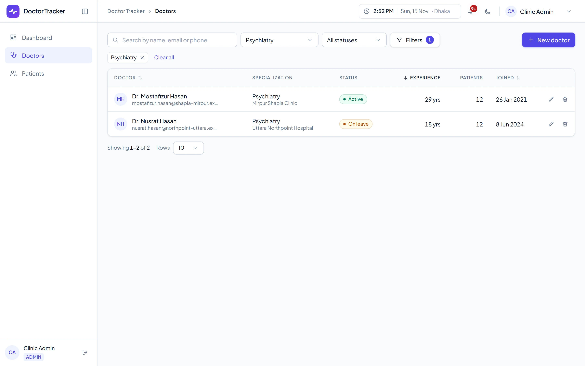 |
| **Doctors** | **Doctors, filtered and sorted** |
| 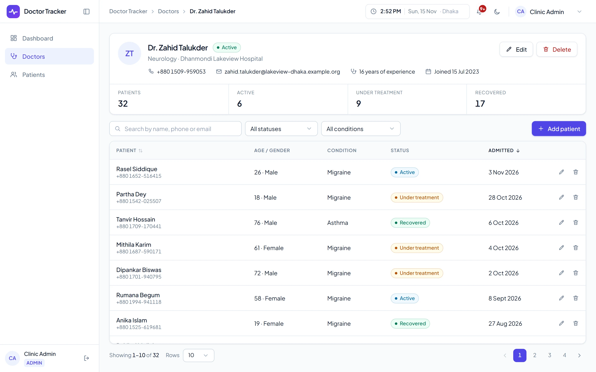 | 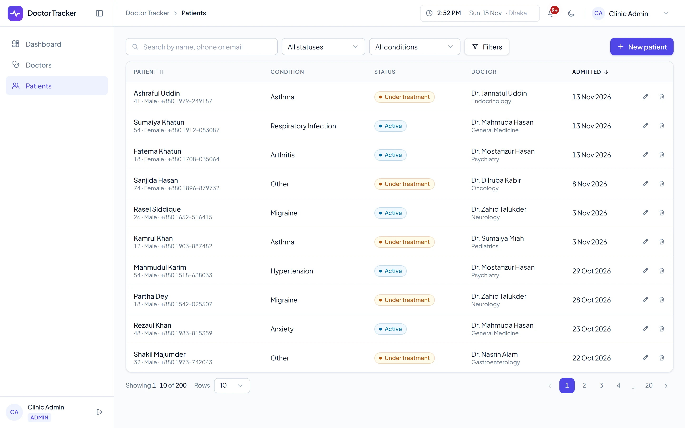 |
| **Doctor profile and their patients** | **Patients** |
| 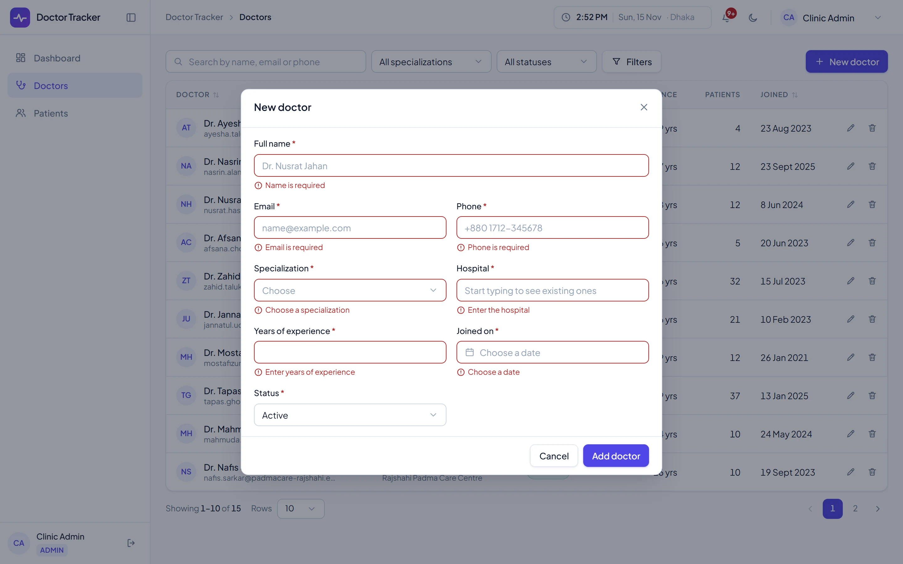 | 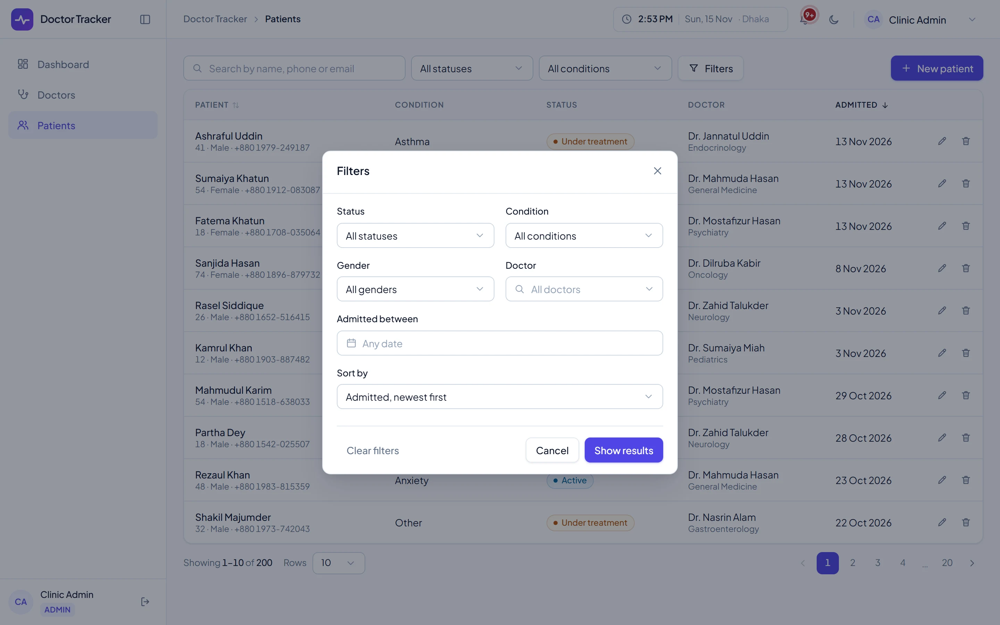 |
| **Create doctor: validation** | **Patient filters with the doctor picker** |
| 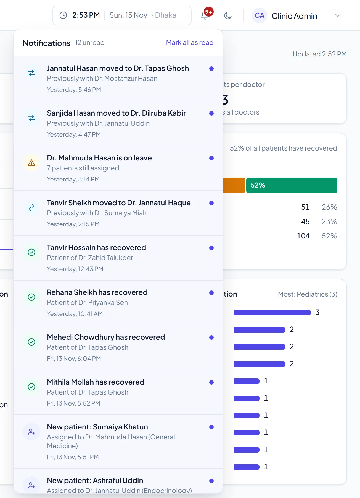 | 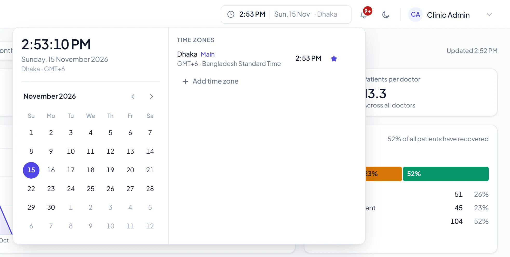 |
| **Notifications** | **Calendar and time zones** |
| 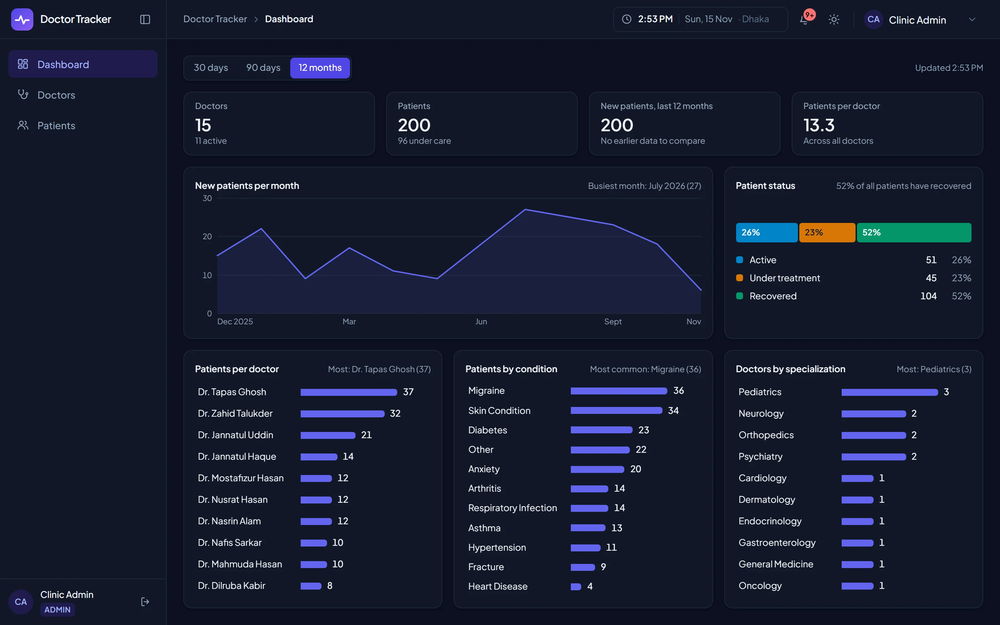 | 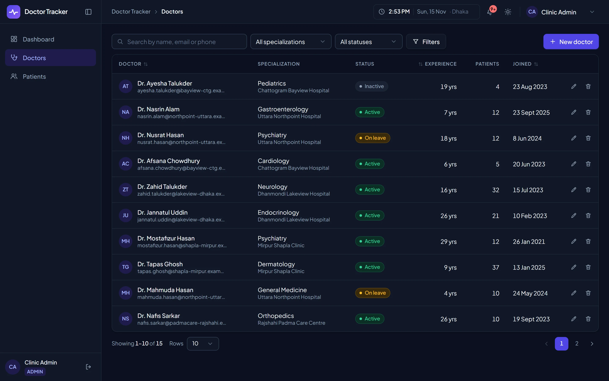 |
| **Dark mode: dashboard (12 months)** | **Dark mode: doctors** |

### Mobile (390 × 844)

| | | |
|---|---|---|
| 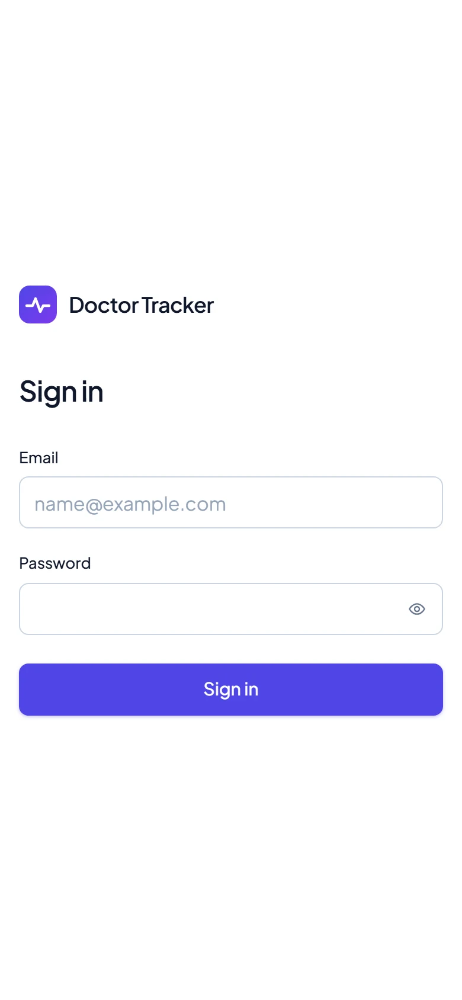 | 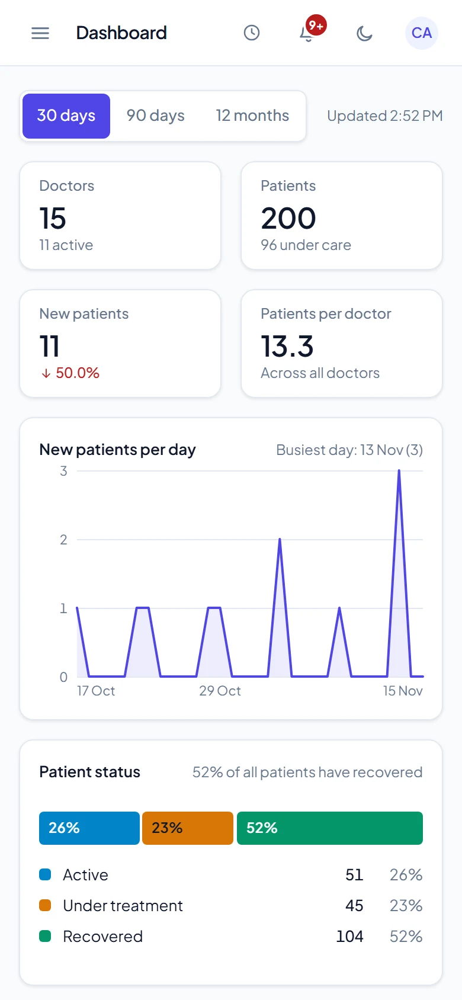 | 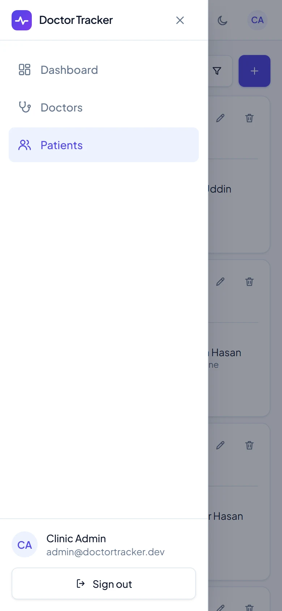 |
| **Sign in** | **Dashboard** | **Navigation drawer** |
| 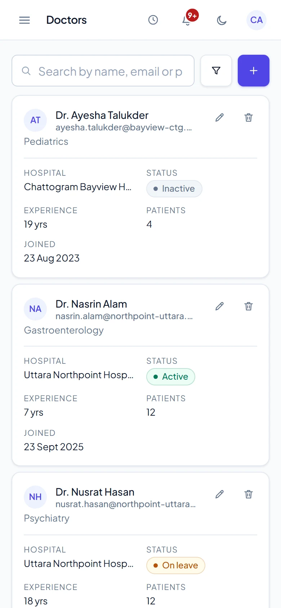 | 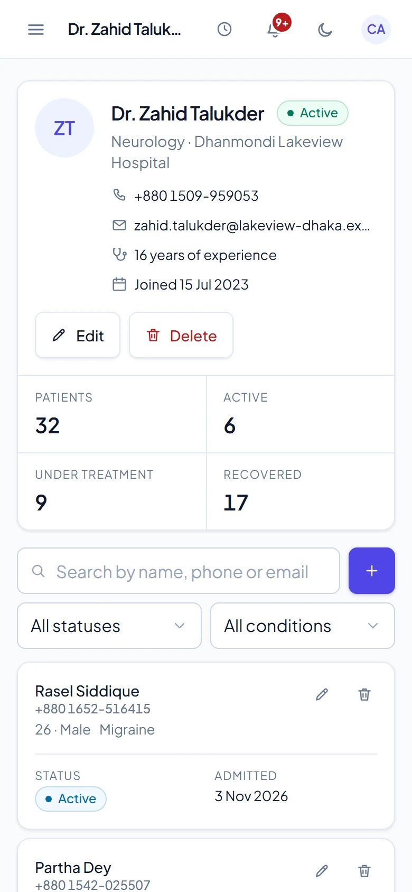 | 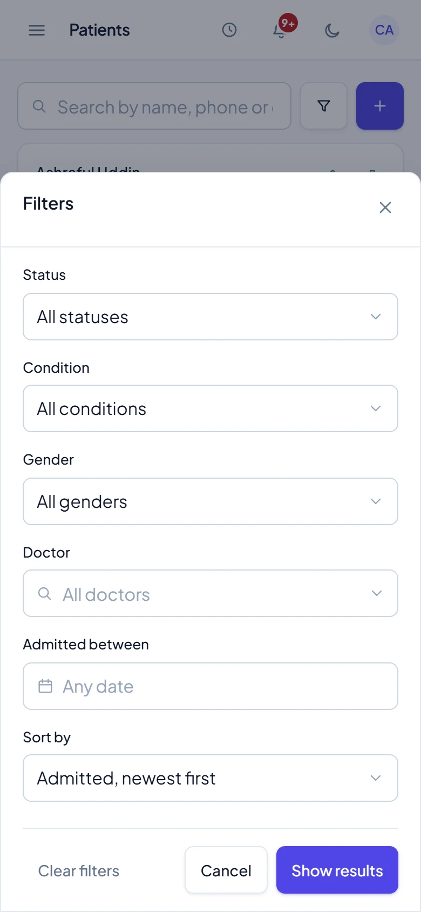 |
| **Doctors (cards)** | **Doctor profile** | **Filters (bottom sheet)** |

---

## Performance and query optimization

### Indexes (ESR: equality → sort → range, `_id` as the tiebreaker for stable pages)

| Collection | Indexes | Serves |
|---|---|---|
| doctors | `{ email: 1 }` unique · `{ searchKey: 1 }` · `{ createdAt: -1, _id: -1 }` · `{ specialization: 1, createdAt: -1, _id: -1 }` · `{ status: 1, createdAt: -1, _id: -1 }` · `{ hospital: 1, createdAt: -1, _id: -1 }` · `{ joinedAt: -1, _id: -1 }` · `{ name: 1, _id: 1 }` | duplicate check, search, default list, each filter, joined-date range, sort by name, dashboard counts |
| patients | `{ doctorId: 1, admissionDate: -1, _id: -1 }` · `{ searchKey: 1 }` · `{ admissionDate: -1, _id: -1 }` · `{ condition: 1, admissionDate: -1, _id: -1 }` · `{ status: 1, admissionDate: -1, _id: -1 }` · `{ name: 1, _id: 1 }` | a doctor's patients + delete guard + per-doctor counts, search, default list + date range + time series, each filter, sort by name |
| notifications | `{ createdAt: -1, _id: -1 }` · `{ readAt: 1, createdAt: -1 }` · `{ subject.id: 1 }` · TTL `{ createdAt: 1 }` (30 days) | the bell list, unread count, clean-up when a doctor or patient is deleted, expiry |
| refreshtokens | `{ tokenHash: 1 }` unique · TTL `{ expiresAt: 1 }` | refresh lookup, automatic expiry |

### Verified with `explain()`

`npm run db:explain` runs every query the app makes and prints its plan. On the seed data all 25 use an index, and none scans the collection:

| Query | Plan | Keys examined / docs examined |
|---|---|---|
| doctors, default list (page 1) | `IXSCAN(createdAt_-1__id_-1)` → `LIMIT` | 10 / 10 |
| doctors, search "sen" | `IXSCAN(searchKey_1)` | 2 / 1 |
| patients, condition filter | `IXSCAN(condition_1_admissionDate_-1__id_-1)` | 10 / 10 |
| patients, one doctor's list | `IXSCAN(doctorId_1_admissionDate_-1__id_-1)` | 10 / 10 |
| dashboard, patients over time | `IXSCAN` → `PROJECTION_COVERED` → `GROUP` | 11 / **0** (covered) |
| dashboard, top doctors / by condition / by status | covered index scans | 200 / **0** |
| dashboard, active doctors / new patients | `COUNT_SCAN` | 11 / **0** |
| notifications, unread count | `COUNT_SCAN(readAt_1_createdAt_-1)` | 12 / **0** |

### Query patterns

- **Pagination:** the page query and `countDocuments` run in parallel with the same filter. The sort always ends with `_id`, so rows never repeat or vanish between pages, and `limit` is capped at 50.
- **No N+1:** a page of patients loads its doctors with one `$in` query; doctor patient counts come from one grouped aggregation per page.
- **Dashboard:** 10 aggregations run in parallel, each on an index (most covered, reading no documents at all). Time buckets are aligned to day, week or month in the clinic's time zone and zero-filled. The result is cached for 60 seconds and cleared by any doctor or patient write.
- **Lean reads and projections:** list queries use `.lean()` and select only the fields the response needs.

### Frontend

- **Prerendered shell:** with Cache Components and Partial Prerendering, the shell is static and instant on navigation, and data streams in behind `Suspense`. The React Compiler removes the need for manual memoisation.
- **Stable layout:** transitions keep the current content on screen while new data loads. Skeletons match the real geometry, and the measured layout shift is 0 (≤ 0.0006 on a first table load at 1440 px and wider).
- **Lean assets:** fonts are self-hosted by `next/font`, the sign-in photo is served as AVIF/WebP (~36 KB on desktop), and there are no UI or chart libraries in the bundle.

---

## Security

- Passwords are hashed with bcrypt. Refresh tokens are stored only as SHA-256 hashes, rotated on every use, and reuse revokes the whole session family.
- Cookies are `httpOnly`, `SameSite=Lax` and `Secure` in production. Same-origin `/api` keeps them first-party.
- Every route checks authentication on the server: `proxy.ts` guards pages and `requireAuth` + `requireRole('admin')` guard the API. Unsafe `?next=` redirects are rejected (no open redirects).
- Rate limits cover sign-in, refresh and the whole API. `TRUST_PROXY` makes them see the real client IP behind a proxy.
- Every input is validated with Zod (params, query, body), and invalid ids return 400 rather than 500. `?status[$ne]=x`-style operator injection is ignored (Express "simple" query parser), and operator keys in bodies are rejected.
- Helmet security headers on the API; security headers on the Next.js app. JSON bodies are capped at 10 kB.
- One error shape (`{ error: { code, message, details } }`) everywhere. Production responses contain no stack traces, and logs never include tokens or passwords.

---

## API reference

All endpoints are under `/api`, return JSON, and (except health and auth) require an admin session. Lists return `{ data, meta: { page, limit, total, totalPages } }`; single resources return `{ data }`.

| Method | Path | Notes |
|---|---|---|
| GET | `/health` | `200 { status, db, uptime }` · `503` when the database is down |
| POST | `/auth/login` | `{ email, password }` → sets `dt_access` + `dt_refresh` cookies |
| POST | `/auth/refresh` | rotates both cookies |
| POST | `/auth/logout` | revokes the session, clears cookies |
| GET | `/auth/me` | the signed-in user |
| GET | `/doctors` | `page, limit, search, specialization, hospital, status, joinedFrom, joinedTo, expMin, expMax, sort` |
| GET | `/doctors/hospitals` · `/doctors/options?search=` | distinct hospitals · up to 20 `{ id, name, specialization }` for pickers |
| GET · PATCH · DELETE | `/doctors/:id` | includes `patientCount` · partial update · `409 DOCTOR_HAS_PATIENTS` while patients are assigned |
| POST | `/doctors` | create · `409` duplicate email |
| GET · POST | `/doctors/:id/patients` | that doctor's patients (same filters as `/patients`) · add a patient under the doctor |
| GET | `/patients` | `page, limit, search, condition, status, gender, doctorId, admittedFrom, admittedTo, sort` |
| GET · PATCH · DELETE | `/patients/:id` | with its doctor · partial update (`doctorId` reassigns) · delete |
| POST | `/patients` | create with `doctorId` · `404 DOCTOR_NOT_FOUND` |
| GET | `/dashboard/stats?range=30d\|90d\|12m` | KPIs, time series, top doctors, breakdowns; cached 60 s |
| GET | `/notifications?limit=` | latest notifications + `meta.unreadCount` |
| PATCH · POST | `/notifications/:id/read` · `/notifications/read-all` | mark one · mark all as read |

Validation errors return `400 { error: { code: "VALIDATION_ERROR", details: [{ path, message }] } }`, one message per field, which the forms show under the matching input. The full contract, with every error code, is in [`docs/doctor-tracker/feature.md`](docs/doctor-tracker/feature.md).

---

## Testing

| Layer | How | Result |
|---|---|---|
| API | `cd backend && npm test`: Vitest + Supertest against an in-memory MongoDB. Covers auth (rotation, reuse, expiry), validation, every endpoint, filters, pagination, the delete guard, dashboard maths and notifications | **98 tests, all passing** |
| Queries | `npm run db:explain`: the plan of every list, search, filter, dashboard and notification query | **25/25 use an index** |
| Frontend | `npm run typecheck`, `npm run lint`, `npm run build` | clean |
| End to end | real-browser runs against the production build (headless Chrome over the DevTools protocol), plus manual scenarios in the [QA guide](docs/doctor-tracker/doctor-tracker_qa_guide.md) | auth 22/22 · shell 26/26 · top bar 20/20 · doctors 32/32 · patients 17/17 · dashboard 18/18 · layout 18/18 |

The browser runs check behaviour that unit tests can't:
- values on screen against the API response;
- keyboard paths;
- layout: no scrollbar at 1280×720 and up, skeletons matching the real boxes, layout shift;
- phone layouts.

---

## Scalability considerations

- **Stateless API.** Access tokens are verified without the database, so the API can run as many instances as needed behind a load balancer.
- **Shared cache and limits.** The dashboard cache and the rate-limit counters are per process today. With several instances, move both to Redis (`express-rate-limit` has a Redis store), and invalidate the cache with a pub/sub message on writes.
- **Deep pages.** Skip/limit pagination is fine for an admin portal's page counts. For very deep pages, switch to cursor pagination on the existing `(sortField, _id)` indexes; no new indexes are needed.
- **Search.** Prefix search on `searchKey` scales with the index. Fuzzy or typo-tolerant search would move to Atlas Search.
- **Analytics.** The dashboard aggregations are index-only today. At much larger volumes, pre-aggregate daily counts on write (or with a scheduled job) and read them from a summary collection or a read replica.
- **Data growth.** Notifications and refresh tokens expire through TTL indexes, so they never grow unbounded. Patients reference doctors by id, which keeps documents small.
- **Frontend.** The app shell is static and cacheable at the edge. Only data requests reach the server.

---

## Deployment notes

The project is deployment-ready; any Node host works. A typical setup is the frontend on Vercel, the API on Render or Railway, and the database on MongoDB Atlas:

| | Frontend (Vercel) | Backend (Render / Railway) |
|---|---|---|
| Root directory | `frontend` | `backend` |
| Build | `npm run build` | `npm ci && npm run build` |
| Start | (managed) | `npm start` |
| Health check | — | `/api/health` |
| Environment | `BACKEND_URL` = the API's public URL | `NODE_ENV=production`, `MONGODB_URI`, `JWT_ACCESS_SECRET`, `FRONTEND_URL` = the frontend URL, `TRUST_PROXY=1`, `ADMIN_EMAIL`, `ADMIN_PASSWORD` |

- `BACKEND_URL` is read when Next.js builds its `/api/*` rewrite. Set it before building, and rebuild if the API URL changes.
- Create the admin on the production database with `npm run seed:admin`. Demo data can be loaded with `npm run seed -- --force`; the flag is required in production because the seed replaces doctors and patients.
- In Atlas, allow the backend host's outbound IPs (or `0.0.0.0/0` for a demo).
- Free Render instances sleep when idle, so the first request after a pause can take about 30 seconds.

---

## Project documentation

The `docs/doctor-tracker/` folder records how the project was planned and built:
- [`feature.md`](docs/doctor-tracker/feature.md): decisions, the completed-module log and the full API contract.
- [`doctor-tracker_fe_guide.md`](docs/doctor-tracker/doctor-tracker_fe_guide.md): frontend rules, design tokens, primitives and the component tree.
- [`doctor-tracker_qa_guide.md`](docs/doctor-tracker/doctor-tracker_qa_guide.md): manual test scenarios and recorded results for every module.
- `milestone-*/module-*/`: the plan, tasks, progress and a learning walkthrough for each module.
- The original specification is in [`docs/requirements/`](docs/requirements/).
